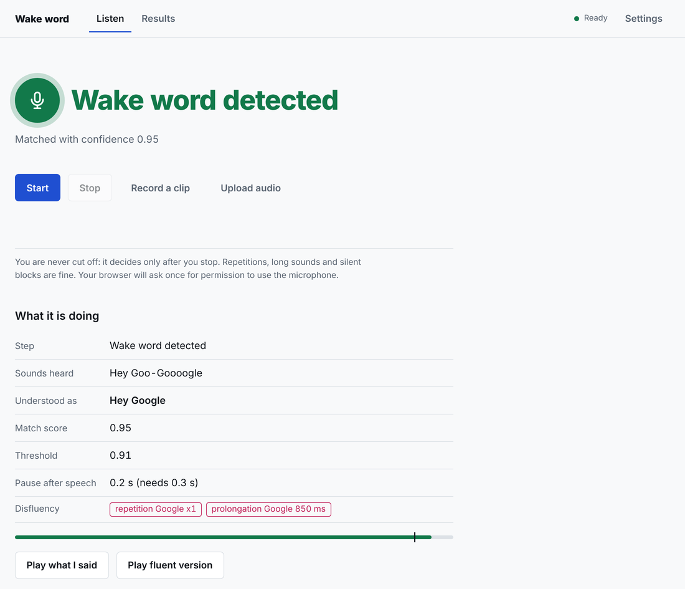
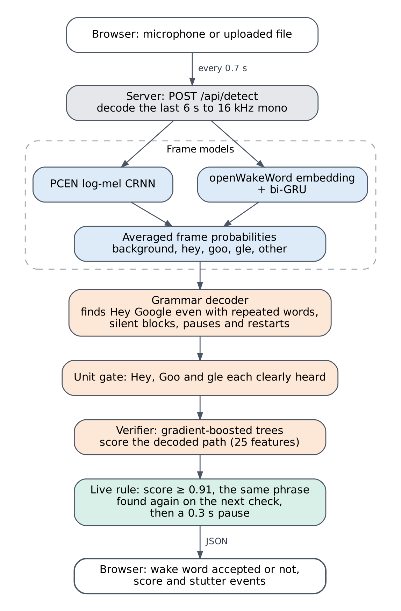
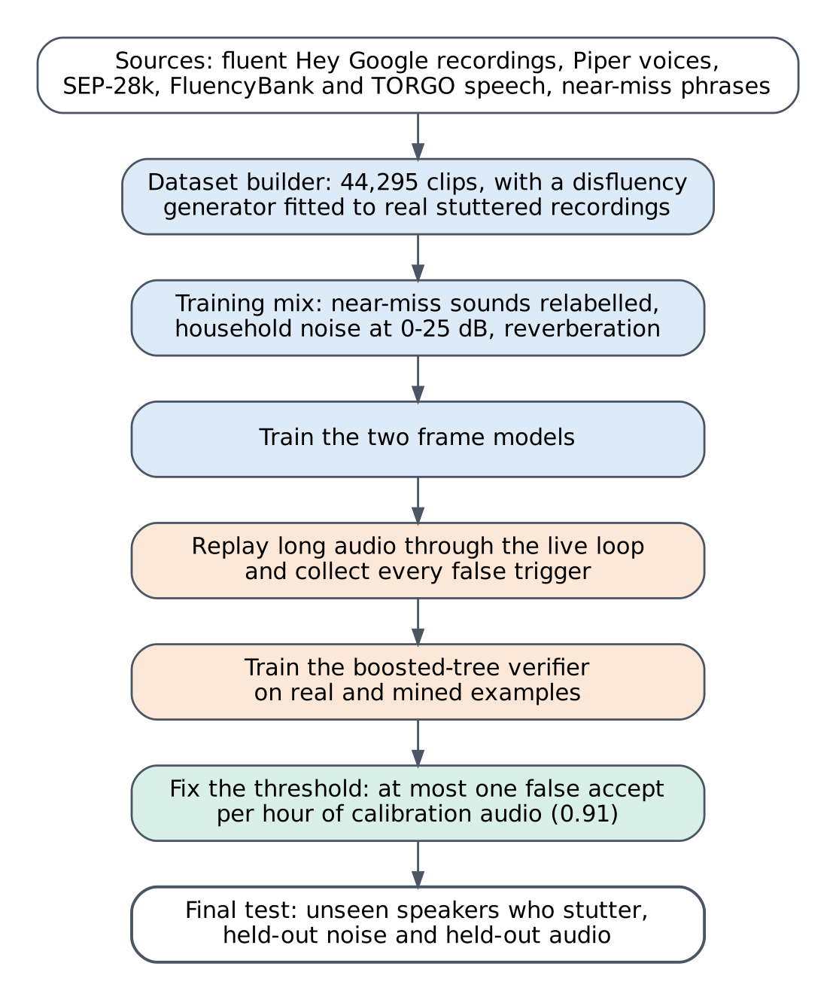
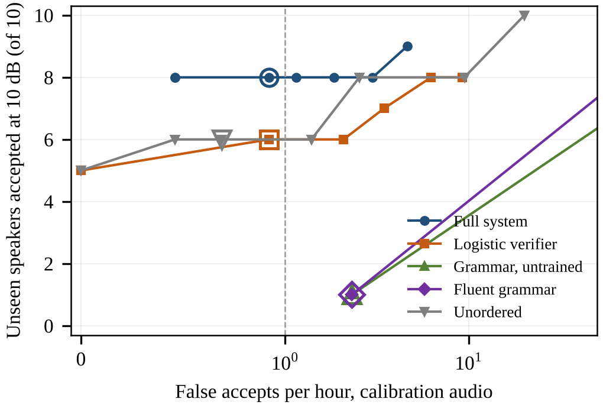

# Wake-Word Detection for People Who Stutter

Voice assistants listen for a fixed phrase such as "Hey Google". Detectors trained on fluent speech often miss
that phrase when the speaker blocks, stretches a sound or repeats part of a word. This project is a "Hey Google"
detector built for people who stutter. It accepts the phrase when it is said with repetitions, prolongations,
silent blocks or restarts, and it rejects other speech, near-miss words such as "Hey Goggle", other wake words
and household noise.

The detector runs as a small web application: open the page, press Start and say the phrase. Each decision shows
the score, the threshold and the stutter events that were found.



## Contents

- [How it works](#how-it-works)
- [How the model was built](#how-the-model-was-built)
- [Results](#results)
- [Repository layout](#repository-layout)
- [Installation](#installation)
- [Running the application](#running-the-application)
- [Sharing a public link](#sharing-a-public-link)
- [Deploying on Oracle Cloud Always Free](#deploying-on-oracle-cloud-always-free)
- [Public and research views](#public-and-research-views)
- [HTTP API](#http-api)
- [Command-line tools](#command-line-tools)
- [Data](#data)
- [Limitations](#limitations)
- [Licences and terms of use](#licences-and-terms-of-use)
- [Authors](#authors)
- [Acknowledgements](#acknowledgements)

## How it works



1. The browser sends the last 6 seconds of microphone audio to the server every 0.7 seconds. An uploaded file
   takes the same path.
2. Two frame models label every 10 ms of audio as background, "hey", "goo", "gle" or other speech. One is a
   convolutional-recurrent network on PCEN log-mel features. The other is a bidirectional GRU on the openWakeWord
   speech embedding. Their outputs are averaged.
3. A grammar decoder searches the frame labels for the phrase. The grammar lets each word repeat and allows
   pauses and restarts at a cost, so an interrupted attempt such as "Hey, Goo... Goo-Google" is treated as one
   attempt. The decoded path also records where the blocks, repetitions and prolongations were.
4. The phrase must pass a unit gate: "Hey", "Goo" and "gle" each have to be clearly heard somewhere on the path.
5. A gradient-boosted tree verifier scores the decoded path from 25 features, such as how well each unit
   matched, how long the gaps were and how many restarts there were.
6. The live rule accepts the phrase only when the score reaches 0.91, the same phrase is found again on the next
   check, and the speaker has paused for 0.3 seconds. The speaker is therefore not cut off in the middle of a
   block.

## How the model was built



- **Dataset.** 44,295 clips: 6,836 fluent and 7,893 disfluent wake-phrase clips and 29,566 negatives, split by
  source into 32,706 training, 6,405 validation and 5,184 test clips. Positive clips come from 117 fluent
  recordings and from Piper text-to-speech voices. A disfluency generator inserts stutter events. Its event rates
  and durations were fitted to real recordings of people who stutter.
- **Near misses.** About 4,400 Piper clips of near-miss phrases, "Google" in sentences, other wake words and
  partial phrases. Where a sound cannot be part of the wake phrase (the "goo" in "Hey Goggle", for example), its
  frames are relabelled so the models learn which part of a near miss is wrong.
- **Noise.** Training clips are mixed with household and office noise (MS-SNSD, MUSAN) at 0-25 dB SNR, with
  random reverberation and band limiting. A noise-suppression front end was also tried. It lowered detection
  accuracy and was dropped.
- **Mined false triggers.** Long negative recordings were replayed through the live loop, and every window that
  triggered the grammar became a training example for the verifier.
- **Threshold.** The threshold is the lowest score that gives at most one false accept per hour on 4.33 hours of
  calibration audio. It was fixed at 0.91 before the test results were computed.

## Results

All results below are for the installed model (v1.7) at threshold 0.91, replayed through the same live rule
that the application uses.
They were measured with the PyTorch version of the two frame models. The application runs the same models
through ONNX Runtime. On 4,474 dataset clips the two versions made the same decision on every one of the 2,374
negatives and on all but 5 of the 2,100 wake-phrase clips, all of which scored within 0.03 of the threshold
(one more accepted, four fewer). Set `WW_BACKEND=torch` to run the PyTorch version instead.

| Test | Result |
|---|---|
| 10 speakers who stutter, not used in training: quiet room | 10 of 10 accepted |
| Same speakers with held-out household noise at 10 dB SNR | 8 of 10 accepted |
| Same speakers at 5 dB SNR | 8 of 10 accepted |
| "Hey Siri" and "Alexa" from the same speakers | 0 of 20 accepted |
| False accepts on 4.89 hours of held-out audio | 2 (0.41 per hour) |
| AUC against 4,622 held-out negatives | 0.994 |
| AUC against near-miss words only | 0.962 |

The plot compares the full system with four simpler variants: a logistic-regression verifier, the grammar score
without a trained verifier, a grammar without pauses or restarts, and a score that ignores word order. Each was
calibrated with the same rule. The dashed line marks one false accept per hour and the large markers are the
chosen operating points. The two grammar-only variants never reach the false-accept budget.



Further details, including results by noise level and the stress tests, are in
[models/RELIABILITY_v17.md](models/RELIABILITY_v17.md).

## Repository layout

```
Wake-word-Recognition-for-People-who-Stutter/
├── run.py                  command-line entry point (python run.py -h)
├── requirements.txt        packages for running the app
├── requirements-train.txt  extra packages for training and exporting the models (PyTorch, ONNX)
├── calibration.json        stutter timing priors used by the dataset builder
├── wakeword/               audio processing, features, disfluency generator, dataset builder,
│                           frame models, decoder, verifier, detector and evaluation
├── server/app.py           Flask application and HTTP API
├── frontend/               web interface (HTML, CSS, JavaScript; no build step)
├── models/                 installed model: frame_model.onnx and frame_emb.onnx (used by the app), their PyTorch
│                           checkpoints frame_model.pt and frame_emb.pt, verifier.json, meta.json
├── pretrained/             openWakeWord melspectrogram and embedding models (ONNX)
├── tests/                  unit and API tests
├── scripts/                export_onnx.py, negative-audio download, stutter-pattern study
├── deploy/oracle/setup.sh  server setup for Oracle Cloud (see below)
└── docs/                   images for this README and literature notes
```

The folders `data/`, `negatives/`, `raw/` and `real_people/` hold training and evaluation audio. They are not part
of the repository (see [Data](#data)).

## Installation

Requirements: Python 3.10 or newer (tested with 3.13 and 3.14), and FFmpeg on the `PATH` for formats other than
WAV. No GPU is needed. PyTorch is not needed to run the app: the two frame models run on ONNX Runtime.

Windows (Command Prompt):

```
git clone https://github.com/POOJASREE-B/Wake-word-Recognition-for-People-who-Stutter.git && cd Wake-word-Recognition-for-People-who-Stutter && python -m venv .venv && .venv\Scripts\python -m pip install -r requirements.txt && .venv\Scripts\python run.py check
```

Linux or macOS:

```
git clone https://github.com/POOJASREE-B/Wake-word-Recognition-for-People-who-Stutter.git && cd Wake-word-Recognition-for-People-who-Stutter && python3 -m venv .venv && .venv/bin/python -m pip install -r requirements.txt && .venv/bin/python run.py check
```

`run.py check` should report `trained model ...... OK, loads (ensemble_v17_fulldata_noise, threshold 0.910)` and
`model backend ...... ONNX Runtime`.

To train or retrain the models, also install the training packages:

```
.venv\Scripts\python -m pip install torch --index-url https://download.pytorch.org/whl/cpu && .venv\Scripts\python -m pip install -r requirements-train.txt
```

## Running the application

Windows:

```
.venv\Scripts\python -m waitress --host=127.0.0.1 --port=8000 --threads=8 --call server.app:create_app
```

Linux or macOS:

```
.venv/bin/python -m waitress --host=127.0.0.1 --port=8000 --threads=8 --call server.app:create_app
```

Open http://127.0.0.1:8000 in Chrome, Edge or Firefox and allow the microphone. Waitress is a production web
server. `python run.py serve` starts the same application on Flask's development server.

## Sharing a public link

Browsers allow the microphone only on `localhost` or over HTTPS. To let other people try the application, put it
behind an HTTPS tunnel or a reverse proxy. With [ngrok](https://ngrok.com/docs/getting-started):

```
ngrok config add-authtoken YOUR_TOKEN
ngrok http 8000
```

Run the second command while the server is running. ngrok prints an `https://` forwarding address that anyone
can open. The link stays online only while both the server and ngrok are running, and the free ngrok plan allows
20,000 requests a month (about four hours of live listening), so it suits short demonstrations.

## Deploying on Oracle Cloud Always Free

Oracle's Always Free tier includes an Arm server that does not expire. With a free DuckDNS name and the Caddy web
server, the application gets a permanent `https://` address on which the microphone works.

**Resources.** Without PyTorch the app uses about 225 MB of memory. Each live check took about 0.85 s on two
2.1 GHz Xeon cores in our tests, and the server works only while someone is speaking; Arm performance was not
measured. Give the server 2 OCPUs and 2 GB of memory.

**Staying active.** Oracle may reclaim an Always Free server that is idle for 7 days, meaning CPU, network and
memory use all stay below 20 %. The setup script keeps the model loaded in memory at all times (a timer calls
`/api/health` every 10 minutes), which keeps memory use at roughly 25-30 % of 2 GB, above that limit. You can
confirm this on the instance's Metrics page in the Oracle console. Do not give the server more memory than it
needs, or the same use falls below 20 %.

Steps:

1. Create an Oracle Cloud Free Tier account. The home region cannot be changed later; Mumbai or Hyderabad is
   closest for users in India.
2. Create a compute instance: image **Canonical Ubuntu 24.04**, shape **VM.Standard.A1.Flex** with 2 OCPUs and
   2 GB of memory, a public IPv4 address, and an SSH key (download and keep the private key).
3. In the instance's subnet, open the security list and add two ingress rules: TCP port 80 and TCP port 443 from
   `0.0.0.0/0`.
4. At [duckdns.org](https://www.duckdns.org), sign in, add a subdomain (for example `heygoogle-stutter`) and set
   its IP address to the server's public IP.
5. Connect to the server from Windows: `ssh -i C:\path\to\private.key ubuntu@SERVER_IP`
6. On the server, run:

   ```
   curl -fsSL https://raw.githubusercontent.com/POOJASREE-B/Wake-word-Recognition-for-People-who-Stutter/main/deploy/oracle/setup.sh | sudo bash -s -- heygoogle-stutter.duckdns.org
   ```

7. Open `https://heygoogle-stutter.duckdns.org`. The certificate is issued automatically on the first visit.

The script installs the app in `/opt/wakeword`, runs it as a systemd service that restarts after a crash or a
reboot, and serves it through Caddy with an automatic Let's Encrypt certificate. To deploy a new version, push it
to GitHub and run the same command again. Useful commands on the server: `sudo systemctl status wakeword` and
`sudo journalctl -u wakeword -f`.

## Public and research views

By default the application shows only **Listen** and **Results**. Three research views are switched off, both in
the page and on the server:

- **Data**: browses and plays the dataset clips.
- **Check**: scores the recordings of the volunteers who stutter.
- **Voice lab**: generates stuttered versions of a recording.

The Data view would serve third-party audio that may not be redistributed, and the Check view lists results for
the volunteers. To turn the research views on for local use, set `WW_RESEARCH=1` before starting the server:

```
set "WW_RESEARCH=1" && .venv\Scripts\python -m waitress --host=127.0.0.1 --port=8000 --call server.app:create_app
```

Do not set it on a public deployment.

## HTTP API

| Method and path | Description |
|---|---|
| `GET /api/health` | Model status, threshold and whether the research views are on |
| `POST /api/detect` | Body: WAV audio, or any format FFmpeg can read. Returns `detected`, `score`, `threshold`, the heard phrase and the stutter events |
| `GET /api/model/report` | Test-set metrics shown on the Results page |

Example:

```
curl -X POST http://127.0.0.1:8000/api/detect -H "Content-Type: audio/wav" --data-binary @clip.wav
```

## Command-line tools

| Command | Purpose |
|---|---|
| `python run.py check` | Checks the environment and loads the model |
| `python run.py test` | Runs the test suite |
| `python run.py detect clip.wav` | Runs the detector on one file and prints the decision |
| `python run.py evaluate --split test` | Scores the test split and writes the metrics used by the Results page (needs `data/`) |
| `python run.py set-threshold 0.91` | Changes the decision threshold |
| `python run.py all --sep28k PATH` | Rebuilds the dataset and retrains (needs the source data and the training packages; takes hours) |
| `python scripts/export_onnx.py` | Exports the trained PyTorch frame models to ONNX and checks that they give the same output; run it after retraining |

`python run.py -h` lists every command.

## Data

The repository contains the code, the trained model and the pretrained openWakeWord files. It does not contain
audio, for two reasons. The datasets are large, and several of them may not be redistributed. The volunteers'
recordings are also kept private.

| Source | Used for | Terms |
|---|---|---|
| SEP-28k | stuttered negative speech | annotations CC BY-NC 4.0; audio copyright of the podcast owners |
| FluencyBank | stuttered negative speech | TalkBank ground rules |
| TORGO | dysarthric negative speech | University of Toronto licence |
| MUSAN | noise, music and speech | per-file Creative Commons or public domain |
| MS-SNSD | household and office noise | MIT |
| ESC-50 | environmental sounds | CC BY-NC 3.0 |
| Free Spoken Digit Dataset | held-out speech | CC BY-SA 4.0 |
| Qualcomm Keyword Speech Dataset | other wake words | non-commercial research only |
| Piper voices | synthetic wake phrases and near misses | per-voice licences |
| The Indian Stammering Association (TISA), Chennai | recordings of people who stutter | provided for this research; not redistributed |

To rebuild the dataset, obtain these sources from their publishers and see `python run.py all -h`.

## Limitations

- The unseen-speaker test has only 10 speakers, so recall moves in steps of 10 % and the confidence intervals
  are wide.
- The same 10 test speakers were scored at several stages of development, so design decisions were not fully
  blind to them.
- Only one wake phrase, "Hey Google", in English, is supported.
- The positive training clips are partly synthetic, and the disfluency generator did not give a measurable gain
  in an earlier speaker-disjoint test.
- The detector has not been evaluated on phones, smart speakers or far-field microphones.

## Licences and terms of use

Third-party software: PyTorch (training only), scikit-learn, NumPy, SciPy and Flask (BSD-3-Clause), ONNX Runtime (MIT), Waitress
(ZPL 2.1), FFmpeg (LGPL 2.1), and the openWakeWord models in `pretrained/` (Apache 2.0).

Several training datasets allow non-commercial use only, so the trained models in `models/` are for research
and other non-commercial use.

## Authors

Pavai D, Rajalakshmi P, Poojasree B and Sanjana R.

## Acknowledgements

We thank The Indian Stammering Association (TISA), Chennai, and the volunteers who recorded the wake phrases, and
the creators of the datasets and software listed above.
